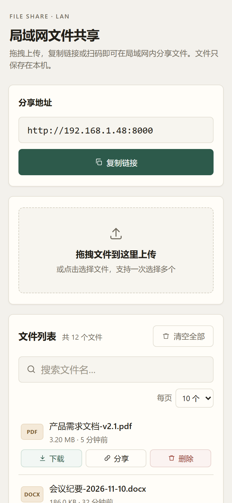

# FileShareTs · 局域网文件共享

> 基于 Hono + TypeScript 的局域网文件共享服务：拖拽上传、链接/扫码分享、搜索分页，可打包为单文件 Windows 可执行程序。


## 功能特性

- **拖拽上传**：支持多选与拖拽，busboy 流式写盘，不把整个文件读入内存。
- **分享与二维码**：自动识别局域网地址，一键复制链接；悬停按钮显示二维码，手机扫码即可访问。
- **搜索与分页**：按文件名实时搜索，分页浏览文件列表，显示大小与修改时间。
- **文件管理**：下载、删除单个文件，或一键清空；中文文件名按 UTF-8 正确处理。
- **单文件 exe**：tsdown + Node SEA 打包，静态页面内嵌，目标机器无需安装 Node.js。
- **OpenAPI 文档**：基于 `@hono/zod-openapi` 自动生成，内置 Scalar 在线文档。
- **运行日志**：pino 同时输出到控制台与 `logs/app.log`。

## 页面预览

| 二维码分享                                | 移动端                                |
| ----------------------------------------- | ------------------------------------- |
|  |  |

## 技术栈

- **后端**：Node.js、TypeScript、Hono、Zod、busboy、pino
- **构建**：pnpm workspace + Turborepo、tsdown（单文件 exe / Node SEA）
- **测试**：Vitest

## 快速开始

要求：Node.js ≥ 22.12、pnpm ≥ 9；打包 exe 需要 Node.js ≥ 25.7。

```bash
cd fileshare-monorepo
pnpm install
cp apps/cmd/.env.example apps/cmd/.env
pnpm dev                    # http://localhost:8000
```

也可以使用根目录的运维脚本（PowerShell 7+）：

```powershell
pwsh ./manage.ps1 install   # 安装依赖并创建 .env
pwsh ./manage.ps1 exe       # 打包 apps/cmd/dist/FileShare.exe
pwsh ./manage.ps1 start     # 后台启动并等待健康检查
pwsh ./manage.ps1 status    # 进程、健康检查、上传目录与日志
```

访问 <http://localhost:8000>，API 文档位于 <http://localhost:8000/api/docs>。

## 目录结构

```text
FileShareTs/
├── fileshare-monorepo/
│   ├── apps/cmd/               # Hono 服务：controllers / services / routes / openapi
│   │   ├── static/             # 前端页面（单文件 HTML）
│   │   └── test/               # Vitest 测试
│   └── packages/               # types、utils、eslint/tsconfig 共享包
├── doc/screenshots/            # README 截图
├── manage.ps1                  # 安装、开发、打包、启停、日志等运维入口
└── README.md
```

## API

所有接口位于 `/api/v1`，错误响应统一为 `{ "detail": "错误信息" }`：

| 方法   | 路径                          | 说明                      |
| ------ | ----------------------------- | ------------------------- |
| GET    | `/api/v1/server-info`         | 获取局域网访问地址        |
| POST   | `/api/v1/upload`              | 上传文件（字段名 `file`） |
| GET    | `/api/v1/files`               | 文件列表                  |
| GET    | `/api/v1/download/{filename}` | 下载文件                  |
| DELETE | `/api/v1/files/{filename}`    | 删除单个文件              |
| DELETE | `/api/v1/files`               | 清空全部文件              |

## 配置

在 `fileshare-monorepo/apps/cmd/.env` 中配置（打包后放在 exe 同目录即可）：

```env
HOST=0.0.0.0
PORT=8000
UPLOAD_DIR=uploads
MAX_FILE_SIZE=104857600
```

## 发布 Release

推送 `v*` 标签会触发 GitHub Actions 在 Windows 上测试、打包并创建 Release：

```bash
git tag -a v1.2.0 -m "v1.2.0"
git push origin v1.2.0
```

也可以在 GitHub 的 **Actions → Release → Run workflow** 中手动填写标签触发。

工作流见 [.github/workflows/release.yml](.github/workflows/release.yml)，产物包含 `FileShare.exe`、`SHA256SUMS.txt` 与 `.env.example`。

## 文档

- [manage.ps1](manage.ps1)：运维脚本，`pwsh ./manage.ps1 -Help` 查看完整参数
- [apps/cmd/.env.example](fileshare-monorepo/apps/cmd/.env.example)：配置模板
- `/api/docs`：运行后的在线 API 文档
- `/api/openapi.json`：OpenAPI 3.1 描述文件

## License

[MIT](LICENSE)
